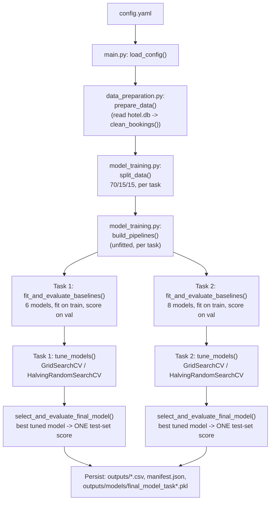

# Hotel Booking Outcome & Pricing — End-to-End ML Pipeline


## Business context
Travelers' Inn (City Hotel and Airport Hotel, Singapore) wants to 

(1) catch bookings that are likely to fall through — either an early **cancellation** or a same-day **no-show** — before it happens, and

(2) understand where its room rates (ADR, Average Daily Rate) look out of line with what similar bookings usually go for, since pricing today is driven by gut feel.

## 1. Overview & folder structure

This project turns the analysis and modelling decisions from `eda.ipynb` into a runnable,
config-driven training pipeline. It solves two independent problems from the same hotel
bookings dataset:

- **Task 1 — Classification.** Predict a booking's final `outcome`: `CHECK-OUT`,
  `CANCELED`, or `NO-SHOW`.
- **Task 2 — Regression.** Predict `adr_clean`, the booking's reference nightly price
  (Average Daily Rate), for real (non-zero) prices.

```
root/
├── eda.ipynb                 # full exploratory analysis — the source of every decision below
├── README.md                 # this file
├── requirements.txt          # pinned dependencies
├── data/
│   └── hotel.db               # raw SQLite export (bookings + reviews tables; only bookings is used)
├── src/
│   ├── main.py                # orchestration entry point
│   ├── data_preparation.py    # row-level cleaning + preprocessing pipeline
│   ├── model_training.py      # split / baseline / tuning / final evaluation
│   └── config.yaml            # single source of truth for every pipeline parameter
└── run.sh                     # executable: runs the pipeline
```

`eda.ipynb` is kept in full because it contains all the exploratory detail — bivariate
analysis, distribution checks, the reasoning behind every cleaning/engineering decision.
This README summarises only what's needed to understand *why* the pipeline is built the
way it is; see the notebook for the full investigation behind each claim.

## 2. Running the pipeline

First, install the pinned dependencies into your Python environment of choice (a venv,
conda env, etc.):

```bash
pip install -r requirements.txt
```

Then run the pipeline:

```bash
./run.sh
```

`run.sh` deliberately does **not** create a virtual environment or install dependencies
itself — it assumes `requirements.txt` has already been installed into whatever
environment it's invoked from, and just runs `src/main.py`. It prints baseline, tuned,
and final test-set results for both tasks to the console and writes everything to
`outputs/`:

```
outputs/
├── task1_baseline_results.csv          # 6 baseline models x validation metrics
├── task1_tuned_results.csv             # 5 tuned models x validation metrics + best_params
├── task1_tuned_best_params.csv
├── task2_baseline_results.csv          # 8 baseline models x validation metrics
├── task2_tuned_results.csv             # 6 tuned models x validation metrics + best_params
├── task2_tuned_best_params.csv
├── closing_summary_baseline_tuned_test.csv
├── manifest.json                       # machine-readable summary of the whole run
└── models/
    ├── final_model_task1.pkl            # {model, fitted pipeline, feature list}
    └── final_model_task2.pkl
```

A full run takes roughly **8-9 minutes** on this project's 2-core reference machine
(down from an initial ~19-21 minutes — see the runtime-optimisation notes in §6 and
`eda.ipynb` §27 for what changed and why); scales with however many cores are actually
available, since most of the tuning searches run with `n_jobs=-1`.

**To change parameters**, edit `src/config.yaml` — nothing else needs to change. Common
adjustments:

| I want to... | Edit... |
|---|---|
| Point at a different database file | `data.db_path` |
| Add/remove a feature | `features.categorical` / `features.numeric_base` |
| Change the train/val/test ratio | `split.train_ratio` / `val_ratio` / `test_ratio` |
| Add a baseline model | a new entry under `models.task1` / `models.task2` |
| Change a model's search space | `tuning.task1.models.<name>.param_grid` |
| Change the ranking metric | `evaluation.task1.ranking_metric` / `task2...` |

To run against a different config file: `./run.sh --config path/to/other.yaml`, or
directly: `python src/main.py --config path/to/other.yaml`.

## 3. Pipeline flow



Each stage maps directly onto a section of `eda.ipynb`:

| Pipeline stage | EDA section(s) |
|---|---|
| `prepare_data()` — row-level cleaning | §2 (raw load), §13.1 (`clean_bookings`) |
| Custom transformers, `build_preprocessing_pipeline()` | §13.3, §14, §16 |
| `split_data()` | §15 |
| `fit_and_evaluate_baselines()` | §17-18 |
| `tune_models()` | §22 |
| `select_and_evaluate_final_model()` | §24 |

The test split is never touched by any stage except the final one-time evaluation in
`select_and_evaluate_final_model()` — exactly like the notebook's own discipline.

## 4. Key EDA findings and how the pipeline reflects them

*(Full detail, plots, and statistical tests are in `eda.ipynb`; this is a summary of
what the pipeline actually does as a result.)*

- **Class imbalance in Task 1.** `outcome` is roughly 64% `CHECK-OUT`, 35% `CANCELED`,
  1% `NO-SHOW`. This drives two pipeline decisions: `class_weight="balanced"` on every
  model that supports it (including `HistGradientBoostingClassifier`, which — unlike the
  classic `GradientBoostingClassifier` — supports `class_weight` natively, so no
  separate `sample_weight`-at-fit-time workaround is needed), and **PR-AUC (macro)** —
  not accuracy — as the ranking metric, since PR-AUC is far more sensitive to how well a
  model finds the rare `NO-SHOW` class.
- **Data-quality issues fixed once, before any split.** Raw `lead_time` has a
  `" days"` suffix; raw `adr` mixes an `SGD ` prefix with two different decimal
  conventions; categorical columns have inconsistent casing, whitespace, and typos
  (e.g. `"NO-DEPOST"` vs `"NO DEPOSIT"`); missing values are spelled `""`, `"-"`,
  `"NA"`, `"UNKNOWN"`, etc. inconsistently across columns. `clean_bookings()` fixes all
  of this deterministically (no row depends on any other row), so it's safe to run once
  on the full dataset before splitting.
- **Leakage columns are explicitly excluded, not just "not selected."** Columns like
  `assigned_room_type` (only known after check-in), `reservation_status`/`_date` (the
  raw form of the Task 1 target itself), and derived target flags are collected into
  `features.leakage_cols` in `config.yaml`, and `split_data()` asserts the feature list
  is disjoint from it before ever building `X`/`y` — a config error can't silently
  reintroduce leakage.
- **Outliers are capped, not dropped.** Six numeric columns (`lead_time_clean`,
  `total_of_special_requests`, `booking_changes`, `days_in_waiting_list`,
  `previous_cancellations`, `previous_bookings_not_canceled`) go through `IQRCapper`
  with a deliberately wide `k=3.0` (vs. the conventional 1.5) — the EDA found these
  "outliers" carry real predictive signal, so only the most extreme leverage points are
  clipped, and every row stays in the dataset.
- **Zero-ADR bookings are excluded from Task 2 only.** ~1,750 bookings have `adr_clean
  == 0` — almost entirely `COMPLEMENTARY`-segment bookings, a structurally different
  population from priced bookings. The EDA tested this on both distributional grounds
  and actual predictive impact (training with vs. without them, evaluated on the same
  validation rows) and confirmed excluding them is, at worst, harmless and usually
  slightly better. `config.yaml`'s `task2.exclude_zero_adr: true` implements this.
- **11 engineered features**, added inside the preprocessing pipeline (fit-safe — no
  leakage across splits): `is_domestic`, `prior_cancellation_flag`, `total_guests`,
  `has_children`, `total_nights`, `commitment_signal`, `high_risk_combo`,
  `lead_time_log`, `month_sin`/`month_cos` (cyclical month encoding), and `year_trend`.
  The strongest of these, `high_risk_combo` (non-refundable deposit combined with a
  Groups/Offline-TA booking channel), showed a Spearman correlation of 0.488 with
  cancellation in the EDA — noticeably stronger than most raw columns individually.

## 5. Feature processing

| Raw column(s) | Cleaning | Engineered? | Imputation | Scaling / Encoding | Task 1 | Task 2 |
|---|---|---|---|---|---|---|
| `hotel`, `meal`, `market_segment`, `distribution_channel`, `deposit_type`, `customer_type`, `promo_code`, `country`, `reserved_room_type` | strip/upper/whitespace-collapse, typo-fix, missing-value consolidation, country→ISO | — | most-frequent | one-hot | ✓ | ✓ |
| `arrival_date_month` | name → 3-letter code (`month_clean`) → numeric 1-12 (`month_num`) | → `month_sin`/`month_cos` | — | one-hot (`month_clean`) / scaled (sin/cos) | ✓ | ✓ |
| `lead_time` | strip `" days"`, numeric-parse, negative values nulled | → `lead_time_log` | median (after IQR cap) | scaled | ✓ | ✓ |
| `adr` | strip `SGD` prefix, disambiguate decimal vs. thousands separator → `adr_clean` | — | median | scaled | ✓ (feature) | target |
| `arrival_date_year`, `arrival_date_day_of_month`, `stays_in_*_nights`, `adults`, `children`, `babies`, `is_repeated_guest`, `previous_*`, `booking_changes`, `days_in_waiting_list`, `required_car_parking_spaces`, `total_of_special_requests` | numeric cast | several (see below) | median (some after IQR cap) | scaled | ✓ | ✓ |
| `company`, `agent` | presence check → `has_company`, `has_agent` (binary) | — | — | scaled (as 0/1 numeric) | ✓ | ✓ |
| `country_clean` | (see above) | → `is_domestic` (SGP flag) | — | scaled | ✓ | ✓ |
| `previous_cancellations` | (see above) | → `prior_cancellation_flag` | — | scaled | ✓ | ✓ |
| `adults`, `children`, `babies` | (see above) | → `total_guests`, `has_children` | — | scaled | ✓ | ✓ |
| `stays_in_weekend_nights`, `stays_in_week_nights` | (see above) | → `total_nights` | — | scaled | ✓ | ✓ |
| `total_of_special_requests`, `required_car_parking_spaces` | (see above) | → `commitment_signal` | — | scaled | ✓ | ✓ |
| `deposit_type_clean`, `market_segment_clean` | (see above) | → `high_risk_combo` | — | scaled | ✓ | ✓ |
| `arrival_date_year` | (see above) | → `year_trend` (relative to min training year) | — | scaled | ✓ | ✓ |
| `lead_time_clean` (post-cap) | — | — | flagged if NaN | `lead_time_clean_was_missing` binary column | ✓ | ✓ |
| `assigned_room_type` | canonicalised | → `room_type_mismatch` (uses `reserved_room_type_clean` too) | — | **excluded** (leakage — the room actually given, only known after check-in; can differ from what was reserved) | ✗ | ✗ |
| `reservation_status`, `reservation_status_date` | canonicalised | → `outcome`, `canceled_flag`, `noshow_flag`, `checkout_flag` | — | **excluded** (these ARE the target / derived from it) | target only | ✗ |

## 6. Model choice rationale

**Baseline roster.** Task 2 starts from a naive benchmark (mean predictor — the floor
every real model must clear) plus a deliberately broad family spread: three linear
variants (Linear, Ridge, Lasso), a single Decision Tree, two ensembles (Random Forest,
Gradient Boosting), and KNN. Task 1's roster is narrower — **6 models, not 8**:
`RidgeClassifier` and L1-penalised Logistic ("Lasso") are excluded from baseline
fitting entirely, not just tuning (see the runtime-optimisation note below and
`eda.ipynb` §27) — both are the same linear decision boundary as plain
`LogisticRegression` with a different penalty, so they add no information Logistic
doesn't already cover, and `RidgeClassifier` additionally can't be scored on PR-AUC
(Task 1's ranking metric). This spread exists to let the data itself reveal whether the
relationship is closer to linear or requires the non-linear splits/interactions a
tree-based model captures — for both tasks here, it turned out to be the latter (Random
Forest wins on validation comfortably in both).

**Hyperparameter tuning roster and search method — the one deliberate departure from
"linear = GridSearchCV, tree = HalvingRandomSearchCV":**

- **Ridge and Lasso are excluded from Task 1's tuning** (and, as above, from its
  baseline fitting too) — not tuned via a lighter method, just not tuned at all. The
  baseline results already showed all three linear variants landing within a few
  thousandths of PR-AUC 0.61 of each other — there's no real headroom a hyperparameter
  search would find, and Lasso's `saga` solver was also the single most expensive model
  to fit in the EDA's timing measurements, for a family that had already shown no
  differentiation. Task 2's Ridge and Lasso remain fully tuned — they're genuinely
  distinct there (different regularisation penalty on a continuous target with no
  probability-output caveat), and inexpensive to search.
- **KNN uses `HalvingRandomSearchCV` in both tasks, not `GridSearchCV`** — despite not
  being a tree model. KNN's fit cost is trivial (it just stores the data), but its
  *scoring* cost during cross-validation is dominated by prediction against the full
  training set for every fold and every candidate. `HalvingRandomSearchCV`'s
  `resource="n_samples"` directly cuts this by scoring early candidates on a small
  subsample and only carrying the strongest ones to larger subsamples — the EDA
  measured this bringing KNN's tuning time down from roughly 190 seconds
  (`GridSearchCV`) to about 6 seconds, with an equivalent-quality result.
  `n_candidates` is capped for Random Forest (15) and Gradient Boosting (12), since
  wider ensembles' training cost scales with tree count in a way subsampling alone
  doesn't fully offset.

**Runtime optimisation (added after the initial design, validated in `eda.ipynb` §27).**
While productionising the notebook's design into this pipeline, a full run measured at
roughly 19-21 minutes on one CPU core. Two further changes cut that to **~8-9 minutes**
without changing which model wins or degrading result quality — both are implemented in
`config.yaml`/`model_training.py`, and re-validated for real inside `eda.ipynb` §27
against the notebook's own fitted objects, not just asserted:

- **`GradientBoostingClassifier`/`Regressor` → `HistGradientBoostingClassifier`/
  `Regressor`, in both tasks.** A histogram-based split-finding algorithm that is
  substantially faster on this dataset's size, with equivalent (in fact, slightly
  better) validation results. This is safe with essentially no ranking risk specifically
  *because* Gradient Boosting was never competitive with Random Forest on either task's
  ranking metric to begin with (baseline: Task 1 PR-AUC 0.666 vs. Random Forest's 0.722;
  Task 2 R² 0.720 vs. Random Forest's 0.907) — swapping a clearly-non-competitive
  model's implementation for a faster one can't plausibly change the winner, and
  `eda.ipynb` §27.3 confirms this directly rather than assuming it.
- **Every tuning search runs with `n_jobs=-1`**, except Random Forest's — it already
  sets `n_jobs=-1` on itself, so its search stays at `n_jobs=1` to avoid nested
  parallelism fighting itself for the same cores. `eda.ipynb` §27.1/27.4 has the full
  measured before/after timing table (e.g. Task 1 Gradient Boosting's tuning search:
  233s → 34s; Task 2's: 160s → 11s).

Random Forest is still selected for both tasks after these changes, with the same final
test-set numbers reported in §7 below.

## 7. Evaluation

**Task 1 (classification) metrics** — computed on the validation split during baseline
fitting and tuning, and once on the test split for the final model:

- **Accuracy** — fraction of correct predictions. Reported for context but not the
  ranking metric here, because it rewards getting the majority classes right and can
  hide poor performance on the rare `NO-SHOW` class.
- **Precision / Recall / F1 (macro)** — computed per class then averaged unweighted, so
  the rare `NO-SHOW` class counts as much as the two common classes rather than being
  drowned out.
- **ROC-AUC (macro, one-vs-rest)** — ranking quality of predicted probabilities against
  each class vs. the rest, averaged. Less sensitive than PR-AUC to class imbalance.
- **PR-AUC (macro, one-vs-rest) — the ranking metric.** Average precision per class,
  averaged unweighted. Far more sensitive than ROC-AUC to how well a model finds a rare
  positive class, which is exactly the signal that matters for `NO-SHOW`.

**Task 2 (regression) metrics:**

- **MAE** — mean absolute error, in the same units as `adr_clean` (dollars); easy to
  interpret directly ("the model is off by about $X on average").
- **MSE / RMSE** — mean squared error and its square root; penalise large errors more
  than MAE does. RMSE is reported in dollars for interpretability.
- **R² — the ranking metric.** Fraction of variance in `adr_clean` explained by the
  model; 1.0 is a perfect fit, 0.0 matches a model that always predicts the mean.

**Final results** (Random Forest was selected for both tasks — see `outputs/manifest.json`
for the exact run that produced these numbers):

| Task | Selected model | Validation (ranking metric) | Test (ranking metric) |
|---|---|---|---|
| Task 1 — classification | Random Forest | PR-AUC 0.7174 | **PR-AUC 0.7095** |
| Task 2 — regression | Random Forest | R² 0.9004 | **R² 0.9362** |

Both tasks' validation-to-test gap is small in the direction expected (a slightly
different, held-out set of rows), which is a reasonable sign against overfitting during
model/hyperparameter selection — a *large* gap in either direction would be the signal
to investigate.

## 8. Deployment considerations

- **Tuning time on a single CPU.** The full pipeline (baselines + tuning + final
  evaluation, both tasks) takes roughly 8-9 minutes on this project's reference machine
  (2 cores) after the runtime optimisations in §6 — down from an initial ~19-21 minutes.
  Random Forest's `HalvingRandomSearchCV` searches are now the dominant remaining cost
  (its search deliberately stays at `n_jobs=1` — see §6 — since the estimator already
  parallelises itself). This is a training-time cost only — inference with the persisted
  models is fast (milliseconds per booking) — but it matters for how often retraining is
  practical; a smaller `n_candidates` cap in `config.yaml`, or running Task 1 and Task 2
  as separate processes on a machine with more cores, are the obvious further levers if
  needed.
- **`RidgeClassifier` and L1-Logistic are excluded from Task 1 entirely** (baseline and
  tuning both, since the runtime-optimisation pass in §6) — a deliberate design choice,
  not an oversight: both are redundant with plain Logistic Regression, and
  `RidgeClassifier` additionally can't be scored on PR-AUC (Task 1's ranking metric)
  without a separate probability calibrator. If a future requirement specifically needs
  `RidgeClassifier`'s predictions (e.g. for an ensemble), re-add it to
  `config.yaml`'s `models.task1` and wrap it with `CalibratedClassifierCV` first to get
  usable probability estimates.
- **Model artifacts are coupled to their exact fitted preprocessing pipeline.** Each
  `outputs/models/final_model_task*.pkl` bundles the fitted model *and* the fitted
  `Pipeline` (imputers, scalers, one-hot encoder vocabulary, IQR-cap bounds — all
  learned from that run's training split) together, plus the feature list. Loading the
  model alone and feeding it raw feature values directly would silently produce wrong
  predictions; always load and use the pipeline+model as a pair (see the bundle's
  `pipeline`/`model`/`feats` keys).
- **No built-in data-drift monitoring.** The pipeline doesn't check whether new data's
  categorical vocabulary (e.g. a `country` or `market_segment` value never seen in
  training) or numeric distributions have shifted from what the models were trained on
  — `OneHotEncoder(handle_unknown="ignore")` prevents a hard crash on an unseen
  category, but silently drops its signal rather than flagging it. In production, this
  would need an explicit monitoring layer (e.g. tracking prediction-input distributions
  over time against the training distribution).
- **No built-in retraining trigger.** The pipeline runs start-to-finish on demand
  (`./run.sh`); there's no scheduled retraining, model-versioning registry, or automatic
  promotion/rollback logic. In a real deployment this would sit behind an orchestrator
  (e.g. a scheduled job that re-runs `main.py` against fresh data and only promotes the
  new model if its test metrics don't regress past some threshold).
